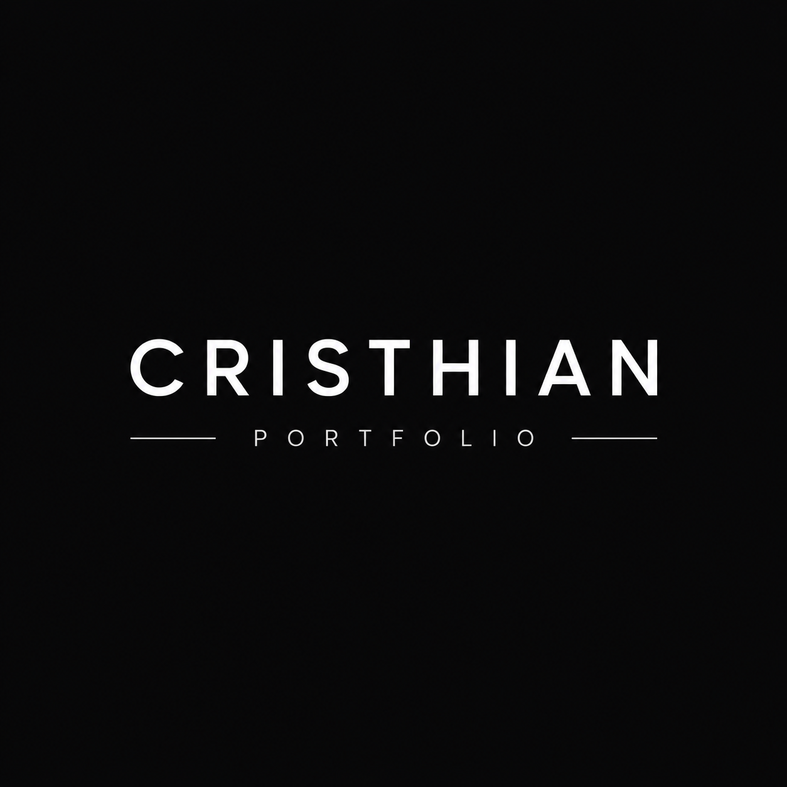

# Portafolio — Cristhian Nunoncca Kuriaki

Portafolio personal de un software engineer especializado en backend, IA y cloud: presentación, proyectos y contacto, en español e inglés.

<p align="center">
  
</p>

## Características

- Cuatro secciones: inicio, sobre mí, proyectos y contacto.
- Bilingüe (español/inglés) con selector en la barra superior; la elección se recuerda.
- Diseño responsive: el contenido nunca queda tapado por elementos decorativos en móvil.
- Sitio estático rápido, sin backend.

## Requisitos

- Node.js 22
- pnpm

## Instalación

```bash
cd portafolio-cristh
pnpm install
```

## Uso

```bash
pnpm dev
```

Abre la URL que muestra Vite (por defecto `http://localhost:5173`). Navega con los enlaces superiores o añadiendo `#proyectos`, `#sobre-mi` o `#contacto` a la URL.

Para generar la versión publicable:

```bash
pnpm build
```

## Scripts

| Comando | Qué hace |
|---|---|
| `pnpm dev` | Arranca en modo desarrollo |
| `pnpm build` | Comprueba los tipos y genera el build de producción |
| `pnpm lint` | Revisa el código con Oxlint |
| `pnpm preview` | Sirve el build localmente |

## Documentación

- Arquitectura: `docs/arquitectura.md`
- Decisiones: `docs/decisiones.md`
- Reglas para agentes: `AGENTS.md`

## Contribuir

1. Crea una rama desde `main` con prefijo de tipo (`feat/`, `fix/`, `chore/`, `docs/`, `refactor/`).
2. Haz el cambio más pequeño que resuelva el problema y verifica con `pnpm build`.
3. Abre la PR con la plantilla del repo y título en Conventional Commits.
